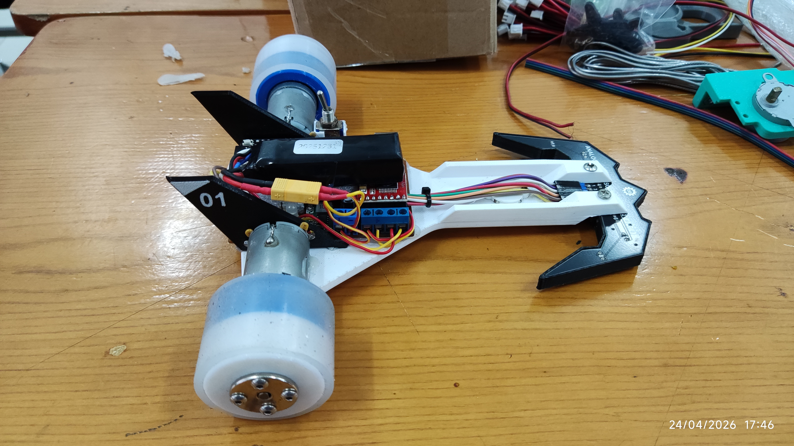
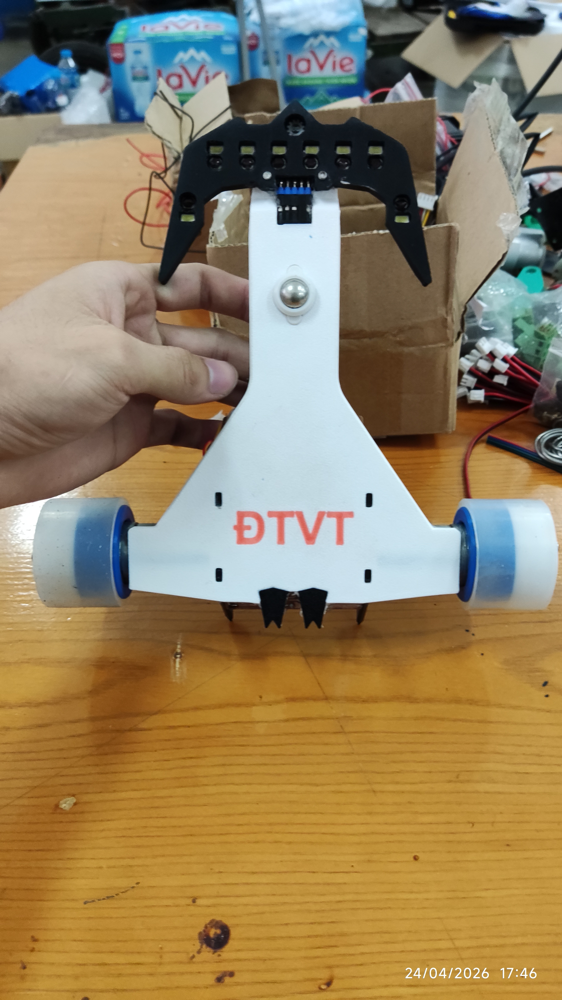
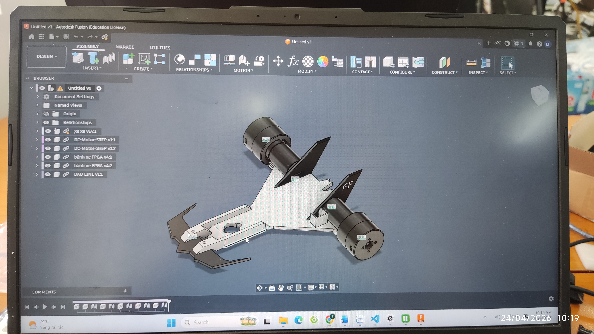
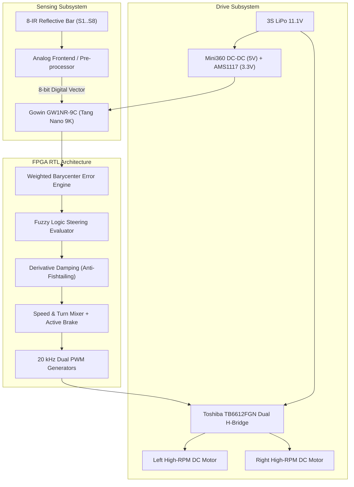

# High-Speed FPGA Line-Following Robot (Tang Nano 9K)


An open-source, competition-grade autonomous line follower robot built on the **Sipeed Tang Nano 9K (Gowin GW1NR-9C FPGA)**. Designed for high-speed tracking with sub-millisecond hardware deterministic control, featuring a **Fuzzy Logic steering engine**, **20 kHz ultrasonic PWM drive**, **active reverse differential braking**, and an **aerodynamic 3D-printed delta chassis**.

---

## 📷 Physical Hardware Showcase

| Assembled Robot (Top View) | Underside & Sensor Array | Fusion 360 CAD Chassis |
| :---: | :---: | :---: |
|  |  |  |

---

## ⚡ Engineering Highlights

- **Hardware-Level Deterministic Control**: Digital control loop executes in pure Verilog RTL at **1,000 Hz (1.00 ms update rate)** directly on the FPGA fabric, completely eliminating operating system jitter or interrupt latency.
- **Fuzzy Logic Steering Engine**: Replaces traditional PID controllers with a fuzzy rule set and dynamic derivative damping ($FZ\_DAMPING$), preventing high-frequency fishtailing down straight tracks.
- **20 kHz Ultrasonic PWM**: Inaudible motor control switching above human hearing range, maximizing motor efficiency and reducing inductive current ripple.
- **Active Differential Reverse Braking**: When entering sharp turns, the inside wheel actively applies reverse polarity torque to rapidly pivot the chassis around corner apexes.
- **Lost-Line Recovery (`QUICK_RECOVER_ON_LOST`)**: Retains the last seen line direction and executes a controlled differential recovery curve to reacquire track without spinning out.
- **Custom Delta Chassis**: Aerodynamically optimized lightweight 3D-printed chassis (`Khung Xe Do Line.stl`) with low center of gravity (CoG) and wide-track rear drive wheels with silicone tires.

---

## 📐 System Architecture



---

## 📋 Hardware Specifications

| Component | Specification | Description |
| :--- | :--- | :--- |
| **FPGA Core** | Gowin GW1NR-LV9QN88PC6/I5 | 8,640 LUT4s, 6,480 Flip-Flops, 27 MHz Onboard Crystal |
| **Motor Driver** | Toshiba TB6612FGN | Dual H-Bridge, 1.2A continuous / 3.2A peak per channel |
| **Sensors** | 8-Channel Reflective Optical Array | Symmetrical boomerang array, 3 mm - 5 mm ground clearance |
| **Motors** | Micro DC High-RPM Geared Motors | High torque, rear-wheel drive configuration |
| **Tires & Hubs** | Custom Silicone Cast Tires | Aluminum D-shaft clamping hubs for zero-slip traction |
| **Front Caster** | Steel Mini Ball Caster | Low friction, multi-directional pivot point |
| **Power Supply** | 3S LiPo Battery (11.1V - 12.6V) | High discharge rating (45C+) with XT30 connector |
| **Regulation** | Mini360 Buck (5V) + AMS1117 (3.3V) | High efficiency step-down + clean low-noise logic rails |

---

## 🔌 Pinout Summary

| Port Name | FPGA Pin (Tang Nano 9K) | Direction | Description |
| :--- | :---: | :---: | :--- |
| `sys_clk` | **52** | Input | 27.000 MHz Onboard Crystal Oscillator |
| `s1` - `s4` | **38, 37, 36, 39** | Input | Left Optical Sensors (Outer to Center) |
| `s5` - `s8` | **25, 26, 27, 28** | Input | Right Optical Sensors (Center to Outer) |
| `PWMA` | **33** | Output | Left Motor 20 kHz PWM Speed Control |
| `IN1`, `IN2` | **34, 40** | Output | Left Motor Direction & Active Reverse Brake |
| `PWMB` | **35** | Output | Right Motor 20 kHz PWM Speed Control |
| `IN4`, `IN3` | **41, 42** | Output | Right Motor Direction & Active Reverse Brake |

*For complete wiring and schematic connections, see [`docs/pinout_and_wiring.md`](file:///d:/My%20Drive/KHO_LUU_TRU_DU_AN/02_ROBOTIC_THI_DAU/FPGA_XeDoLine/BACKUP%20CODE%20CHUAN/docs/pinout_and_wiring.md).*

---

## 🚀 Quick Start: Building & Flashing

### Requirements
- **Gowin EDA** (V1.9.9+ or V1.9.11 Education / Standard)
- **Gowin Programmer** (bundled with Gowin EDA)
- **USB-C Data Cable** connected to Tang Nano 9K

### Step-by-Step Instructions
1. Clone this repository:
   ```bash
   git clone https://github.com/vthinh-la/FPGA-Line-Follower-Robot.git
   cd FPGA-Line-Follower-Robot
   ```
2. Launch Gowin EDA, select **File -> Open Project**, and open [`firmware/gowin_fpga/FPGA_DO_LINE.gprj`](file:///d:/My%20Drive/KHO_LUU_TRU_DU_AN/02_ROBOTIC_THI_DAU/FPGA_XeDoLine/BACKUP%20CODE%20CHUAN/firmware/gowin_fpga/FPGA_DO_LINE.gprj).
3. In the Design Process pane:
   - Double click **Synthesize** to compile the Verilog source.
   - Double click **Place & Route** to generate the bitstream.
4. Launch **Programmer**:
   - Device: `GW1NR-9C` (`GW1NR-LV9QN88PC6/I5`).
   - Operation: **sSRAM Program** (for temporary test) or **Embedded Flash Program** (for permanent boot on power-up).
   - Select bitstream file: [`firmware/gowin_fpga/bitstream/FPGA_DO_LINE.fs`](file:///d:/My%20Drive/KHO_LUU_TRU_DU_AN/02_ROBOTIC_THI_DAU/FPGA_XeDoLine/BACKUP%20CODE%20CHUAN/firmware/gowin_fpga/bitstream/FPGA_DO_LINE.fs).
   - Click **Program / Configure**.

---

## 📁 Repository Structure

```text
├── README.md                          # Project documentation
├── LICENSE                            # MIT Open Source License
├── .gitignore                         # Git exclusion rules
├── docs/                              # Technical engineering guides
│   ├── architecture.md                # System and RTL architecture breakdown
│   ├── fuzzy_control.md               # Fuzzy Logic control algorithm details
│   ├── pinout_and_wiring.md           # Pinout and electrical interconnects
│   ├── bom.md                         # Bill of Materials
│   ├── assembly.md                    # 3D printing and physical assembly guide
│   └── calibration_and_tuning.md      # Calibration and track tuning procedures
├── hardware/                          # Electronic hardware files
│   ├── schematics/                    # EasyEDA circuit schematic
│   └── pcb/                           # PCB layout reference
├── firmware/                          # FPGA RTL source and project
│   └── gowin_fpga/
│       ├── FPGA_DO_LINE.gprj          # Gowin EDA project file
│       ├── src/                       # Verilog HDL source & constraints
│       │   ├── main.v                 # Core RTL controller
│       │   ├── FPGA_DO_LINE.cst       # Physical pin constraints
│       │   └── FPGA_DO_LINE.sdc       # Timing constraints (27 MHz)
│       └── bitstream/                 # Compiled ready-to-flash bitstream
│           └── FPGA_DO_LINE.fs
├── mechanical/                        # Mechanical 3D CAD files
│   ├── 3d_models/                     # 3D printable STL files
│   │   └── chassis_frame.stl          # Main aerodynamic chassis
│   └── specs.md                       # Mechanical dimensions and specs
└── media/                             # Real photographs and CAD captures
    ├── robot_assembled_top.jpg
    ├── robot_underside_sensors.jpg
    └── cad_assembly_fusion360.jpg
```

---

## 📄 License & Credits

- Hardware & Firmware: Released under the **MIT License**.
- Designed and fabricated by **vthinh-la** (ICTU - Thai Nguyen University of Information and Communication Technology).
