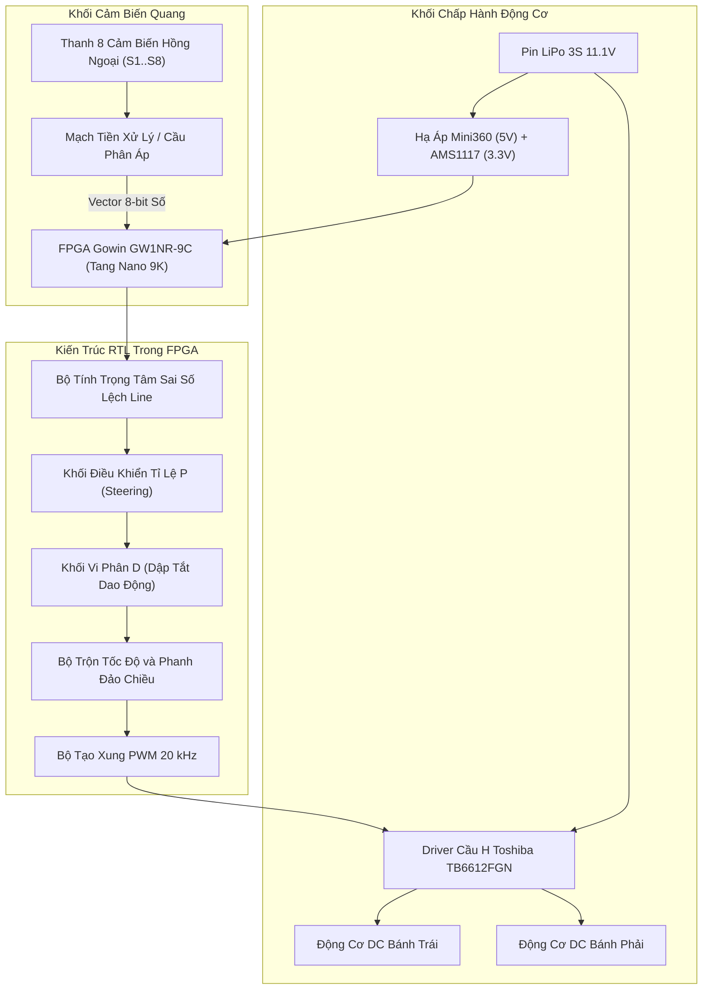

# Xe Dò Line Tốc Độ Cao Điều Khiển Bằng FPGA (Tang Nano 9K)


Dự án phần cứng và mã nguồn mở cho **Robot dò line tốc độ cao (High-Speed Line Follower Robot)** sử dụng FPGA **Sipeed Tang Nano 9K (Gowin GW1NR-9C)** làm bộ xử lý trung tâm thời gian thực. Hệ thống ứng dụng giải thuật **điều khiển PID phân cấp**, **xung PWM 20 kHz siêu âm**, **phanh chủ động đảo chiều vi sai (Active Reverse Braking)** và **khung xe in 3D delta khí động học**, giúp xe bám đường ổn định ở tốc độ cao mà không bị văng đuôi (fishtailing).

---

## 📷 Hình Ảnh Phần Cứng Thực Tế

| Xe Lắp Ráp Hoàn Chỉnh (Mặt Trên) | Cảm Biến 8 Kênh và Chữ ĐTVT (Mặt Dưới) | Bản Vẽ Lắp Ráp CAD Fusion 360 |
| :---: | :---: | :---: |
|  |  |  |

---

## ⚡ Điểm Nổi Bật Về Kỹ Thuật

- **Xử lý số thời gian thực trên phần cứng (Hardware Deterministic Control)**: Vòng lặp điều khiển PID thực thi trực tiếp trên phần cứng Verilog RTL với chu kỳ chính xác **1,000 Hz (1.00 ms)**, triệt tiêu hoàn toàn hiện tượng trễ ngắt hay jitter của vi điều khiển truyền thống.
- **Giải thuật điều khiển PID phân cấp**:
  - Tính toán sai số vị trí theo phương pháp trọng tâm (Weighted Barycenter) từ 8 cảm biến hồng ngoại.
  - Khâu tỉ lệ P phân cấp theo biên độ lệch giúp xe đằm lái ở đoạn thẳng và quẹo gắt dứt khoát khi vào cua.
  - Khâu vi phân D (Dynamic Damping) dập tắt xung quán tính văng thân xe, chống hiện tượng lắc đuôi cá khi chạy tốc độ cao.
- **Xung PWM 20 kHz siêu âm**: Tần số đóng cắt vượt ngưỡng nghe của tai người, giúp động cơ chạy cực êm, không bị rít, giảm tổn hao nhiệt và tăng tuổi thọ động cơ.
- **Phanh chủ động đảo chiều vi sai (Active Reverse Braking)**: Khi vào các góc cua tay áo hoặc góc vuông, động cơ phía trong cua được đảo ngược phân cực cầu H để hãm chủ động, giúp xe ôm sát cua cực hẹp mà không bị trượt quán tính ra khỏi sa hình.
- **Tự động tăng tốc đoạn thẳng (Straight Line Boost)**: Khối so mẫu phần cứng phát hiện đường thẳng hoàn hảo, tự động nâng xung ga lên mức tối đa (`DUTY_STRAIGHT = 60%`).
- **Tự phục hồi khi mất vạch (`QUICK_RECOVER_ON_LOST`)**: Lưu vết hướng vạch cuối cùng và điều khiển vi sai hai bánh để xe tự quay đầu bắt lại vạch một cách mượt mà.
- **Khung xe in 3D khí động học**: Thiết kế dạng delta trọng tâm thấp, hốc gắn cảm biến tối ưu khí động học và lốp cao su silicon đúc bám đường chống trượt.

---

## 📐 Sơ Đồ Khối Hệ Thống



---

## 📋 Thông Số Kỹ Thuật Phần Cứng

| Hạng mục | Thông số | Mô tả chi tiết |
| :--- | :--- | :--- |
| **Chip xử lý chính** | Gowin GW1NR-LV9QN88PC6/I5 | 8,640 LUT4, 6,480 FF, Thạch anh tích hợp 27.000 MHz |
| **Bo mạch FPGA** | Sipeed Tang Nano 9K | Thiết kế nhỏ gọn, giao tiếp nạp qua USB-C tích hợp BL702 |
| **Driver động cơ** | Toshiba TB6612FGN | Cầu H kép, dòng liên tục 1.2A / đỉnh 3.2A mỗi kênh |
| **Cảm biến dò line** | Mảng 8 kênh hồng ngoại phản xạ | Dạng cánh cung đối xứng, khoảng cách mặt đất 3 mm - 5 mm |
| **Động cơ chấp hành** | Động cơ DC Micro giảm tốc | Tốc độ cao, lực kéo khỏe, dẫn động 2 bánh sau |
| **Bánh xe và Khớp nối** | Bánh bọc cao su silicon | Khớp nối trục nhôm D-shaft chống trượt tuyệt đối |
| **Bánh dẫn hướng** | Bi cầu kim loại đa hướng (Ball Caster) | Ma sát thấp, xoay tự do 360 độ ở đầu mũi xe |
| **Nguồn cấp** | Pin LiPo 3S (11.1V - 12.6V) | Dòng xả cao 45C+, jack cắm chuẩn XT30 |
| **Mạch nguồn** | Module Buck Mini360 + AMS1117-3.3V | Hiệu suất cao, cung cấp nguồn 5V cho cảm biến và 3.3V cho FPGA |

---

## 🔌 Bảng Gán Chân FPGA (Pinout)

| Tên Cổng | Chân FPGA (Tang Nano 9K) | Hướng | Chức năng kết nối |
| :--- | :---: | :---: | :--- |
| `sys_clk` | **52** | Vào | Xung nhịp hệ thống 27.000 MHz |
| `s1` - `s4` | **38, 37, 36, 39** | Vào | Cảm biến hồng ngoại bên Trái (Từ ngoài vào trong) |
| `s5` - `s8` | **25, 26, 27, 28** | Vào | Cảm biến hồng ngoại bên Phải (Từ trong ra ngoài) |
| `PWMA` | **33** | Ra | Điều xung tốc độ Bánh Trái (PWM 20 kHz) |
| `IN1`, `IN2` | **34, 40** | Ra | Chiều quay và Phanh đảo chiều Bánh Trái |
| `PWMB` | **35** | Ra | Điều xung tốc độ Bánh Phải (PWM 20 kHz) |
| `IN4`, `IN3` | **41, 42** | Ra | Chiều quay và Phanh đảo chiều Bánh Phải |

*Xem chi tiết sơ đồ đấu dây và điện áp tại [`docs/pinout_and_wiring.md`](docs/pinout_and_wiring.md).*

---

## 🚀 Hướng Dẫn Biên Dịch & Nạp Bitstream

### Yêu Cầu Môi Trường
- Phần mềm **Gowin EDA** (phiên bản V1.9.9 trở lên hoặc V1.9.11 Education/Standard).
- Cáp kết nối **USB-C** nối máy tính với cổng nạp trên bo Tang Nano 9K.

### Các Bước Thực Hiện
1. Tải repository về máy:
   ```bash
   git clone https://github.com/vthinh-la/FPGA-Line-Follower-Robot.git
   cd FPGA-Line-Follower-Robot
   ```
2. Mở Gowin EDA, chọn **File -> Open Project**, trỏ tới file dự án:
   - [`firmware/gowin_fpga/FPGA_DO_LINE.gprj.xml`](firmware/gowin_fpga/FPGA_DO_LINE.gprj.xml) *(Nếu dùng Gowin EDA, bạn có thể đổi tên thành `.gprj`)*.
3. Trong cửa sổ **Design Process**:
   - Nhấn đúp chuột vào **Synthesize** để biên dịch mã nguồn Verilog.
   - Nhấn đúp chuột vào **Place & Route** để tạo file bitstream.
4. Mở công cụ **Programmer**:
   - Chọn Thiết bị: `GW1NR-9C` (`GW1NR-LV9QN88PC6/I5`).
   - Kiểu nạp: **sSRAM Program** (nạp thử nghiệm tạm thời) hoặc **Embedded Flash Program** (nạp cố định vào Flash để xe tự chạy khi bật nguồn).
   - Chọn file bitstream có sẵn: [`firmware/gowin_fpga/bitstream/FPGA_DO_LINE.fs`](firmware/gowin_fpga/bitstream/FPGA_DO_LINE.fs).
   - Nhấn **Program / Configure** để hoàn tất nạp.

---

## 📁 Cấu Trúc Thư Mục Repository

```text
├── README.md                          # Tài liệu giới thiệu tổng quan dự án (Tiếng Việt)
├── LICENSE                            # Giấy phép mã nguồn mở MIT
├── .gitignore                         # Danh sách loại trừ file tạm, file build và báo cáo .docx
├── docs/                              # Tài liệu kỹ thuật chi tiết
│   ├── architecture.md                # Kiến trúc hệ thống và luồng dữ liệu RTL 1ms
│   ├── pid_control.md                 # Chi tiết giải thuật điều khiển PID và chống văng đuôi
│   ├── pinout_and_wiring.md           # Bảng tra chân kết nối và sơ đồ nguồn
│   ├── bom.md                         # Bảng danh mục linh kiện (Bill of Materials)
│   ├── assembly.md                    # Hướng dẫn in 3D và các bước lắp ráp xe
│   └── calibration_and_tuning.md      # Quy trình căn chỉnh cảm biến và thông số PID trên sân
├── hardware/                          # Thiết kế phần cứng điện tử
│   ├── schematics/Schematic_FPGA.png  # Sơ đồ nguyên lý thiết kế từ EasyEDA
│   └── pcb/PCB_Layout.png             # Mặt bằng bố trí linh kiện PCB
├── firmware/                          # Mã nguồn và cấu hình FPGA
│   └── gowin_fpga/
│       ├── FPGA_DO_LINE.gprj.xml      # File dự án Gowin EDA
│       ├── src/                       # Mã nguồn Verilog và ràng buộc
│       │   ├── main.v                 # RTL điều khiển chính (PID, PWM, Phanh đảo chiều)
│       │   ├── FPGA_DO_LINE.cst       # Ràng buộc gán chân phần cứng
│       │   └── FPGA_DO_LINE.sdc       # Ràng buộc tần số xung nhịp 27 MHz
│       └── bitstream/                 # File nhị phân bitstream đã biên dịch sẵn
│           └── FPGA_DO_LINE.fs
├── mechanical/                        # Thiết kế cơ khí
│   ├── 3d_models/chassis_frame.stl    # File STL in 3D khung xe
│   └── specs.md                       # Thông số kích thước và trọng tâm xe
└── media/                             # Hình ảnh chụp thực tế sản phẩm
    ├── robot_assembled_top.jpg        # Ảnh mặt trên xe thực tế
    ├── robot_underside_sensors.jpg    # Ảnh mặt dưới cảm biến và chữ ĐTVT
    └── cad_assembly_fusion360.jpg     # Ảnh thiết kế CAD trên Fusion 360
```

---

## 📄 Bản Quyền & Tác Giả

- Dự án được phát hành theo giấy phép mã nguồn mở **MIT License**.
- Thiết kế, chế tạo và lập trình bởi: **vthinh-la** (Lê Anh Thịnh - Khoa Điện Tử Viễn Thông, Trường Đại học Công nghệ Thông tin và Truyền thông - Đại học Thái Nguyên - ICTU).
