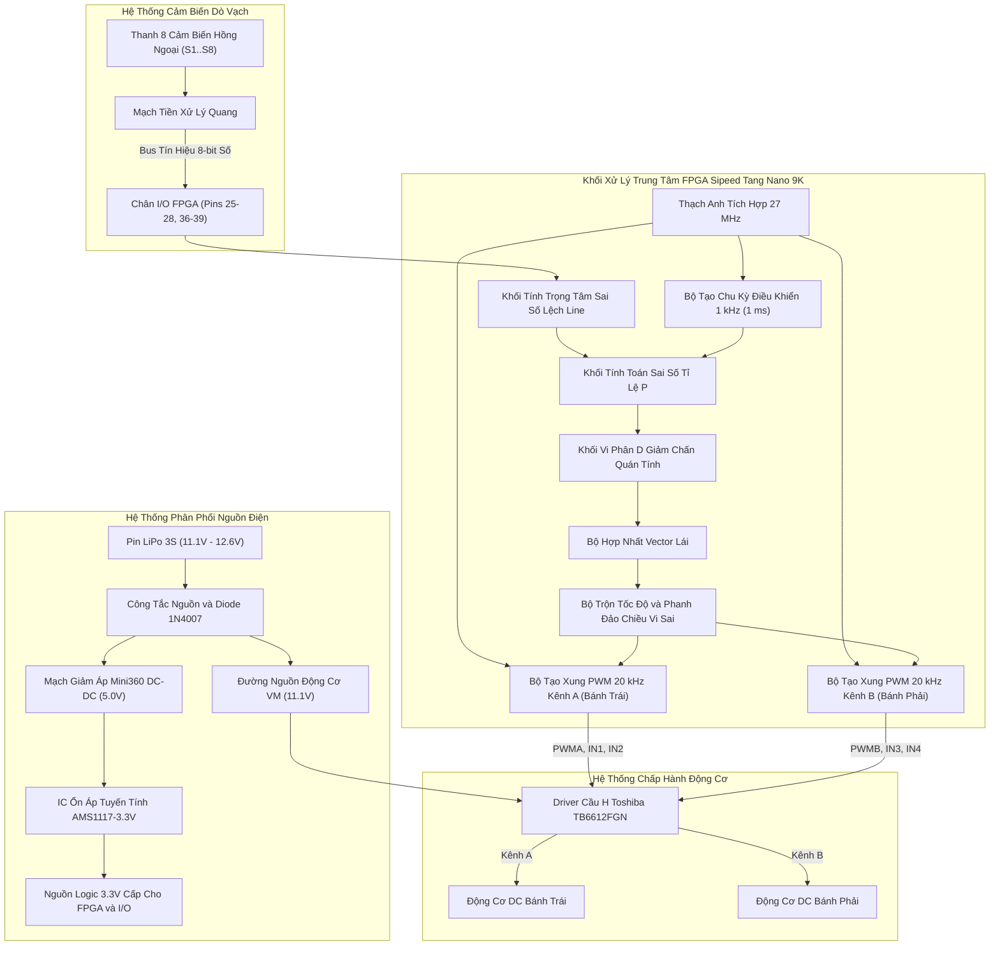

# Kiến Trúc Hệ Thống & Luồng Dữ Liệu Phần Cứng

Tài liệu mô tả chi tiết kiến trúc phần cứng điện tử và luồng thực thi trong FPGA của Robot Dò Line Tốc Độ Cao.

---

## 1. Sơ Đồ Kiến Trúc Toàn Hệ Thống

---

## 2. Thông Số Tài Nguyên RTL Trên FPGA

- **Dòng chip FPGA**: Gowin Semiconductor GW1NR-LV9QN88PC6/I5 (Tang Nano 9K).
- **Tần số xung nhịp chính**: 27.000 MHz (Clock period: 37.037 ns).
- **Tần số sóng mang PWM**: 20.000 kHz (Chu kỳ: 1,350 chu kỳ clock tại 27 MHz).
- **Tần số vòng lặp điều khiển PID**: 1,000 Hz (Cập nhật góc lái và ga mỗi 1.00 ms).
- **Tài nguyên logic sử dụng**: ~600 LUT4 (< 7% tổng số 8,640 LUT của chip).
- **Điện áp chân I/O**: Chuẩn LVCMOS 3.3V với điện trở kéo lên nội (PULL_UP).
