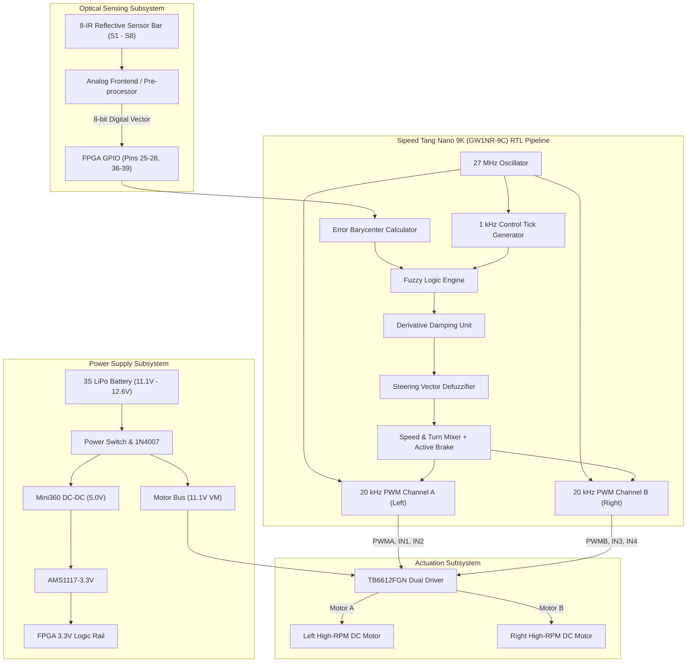

# System & RTL Architecture

Technical specifications of the FPGA High-Speed Line Follower Robot architecture.

---

## Hardware RTL Specifications

- **Target FPGA**: Gowin Semiconductor GW1NR-LV9QN88PC6/I5 (Tang Nano 9K)
- **Onboard Frequency**: 27.000 MHz
- **Logic Utilization**: ~600 LUT4s (< 7% of GW1NR-9 resource budget)
- **PWM Carrier Frequency**: 20.000 kHz
- **Control Loop Update Rate**: 1,000 Hz (1.00 ms cycle)
- **Clock Period**: 37.037 ns (Constrained via `FPGA_DO_LINE.sdc`)
